# UTC Shader Library for Unreal Engine

Easily create master materials in Unreal Engine. Now works with Legacy and Substrate materials. 

Supports Unreal Engine 5.8. Versions for older engines are on the `1.x-UE5.x` branches.

Feedback is welcome and helps improve the plugin.

## Links

* Marketplace: https://www.unrealengine.com/marketplace/en-US/product/utc-shader-library
* Trailer: https://www.youtube.com/watch?v=v8OMGxTqgyI
* Demo / tutorial: https://www.youtube.com/watch?v=5c1hgwKFKVM
* Development news on X (Twitter): https://twitter.com/UTCompiler

## What is it for?

The UTC Shader Library saves time when building master materials by removing repetitive work. It provides:

* a library of common material functions,
* automatic creation of nodes and parameters,
* organized material instances, with automatic parameter group names and sort priorities.

It is aimed at beginners in Unreal and shaders as well as advanced users who want to build shaders faster.

The plugin has three parts:

* **Master Materials Generator** (MMG), built on the material function library
* **Material Function Library**
* A simple **RDG example** for compute, pixel and vertex shaders

## Installation

1. Download the repository as a ZIP and extract it into your project's `Plugins` folder (`YourProject/Plugins`).
2. In Unreal, open `Edit > Plugins`, find UTC Shader Library, enable it and restart the editor.

The plugin ships as source code, so Visual Studio is required to compile it.

# Master Materials Generator

Open the generator from `Window > Get Content > UTC Materials Generator`.

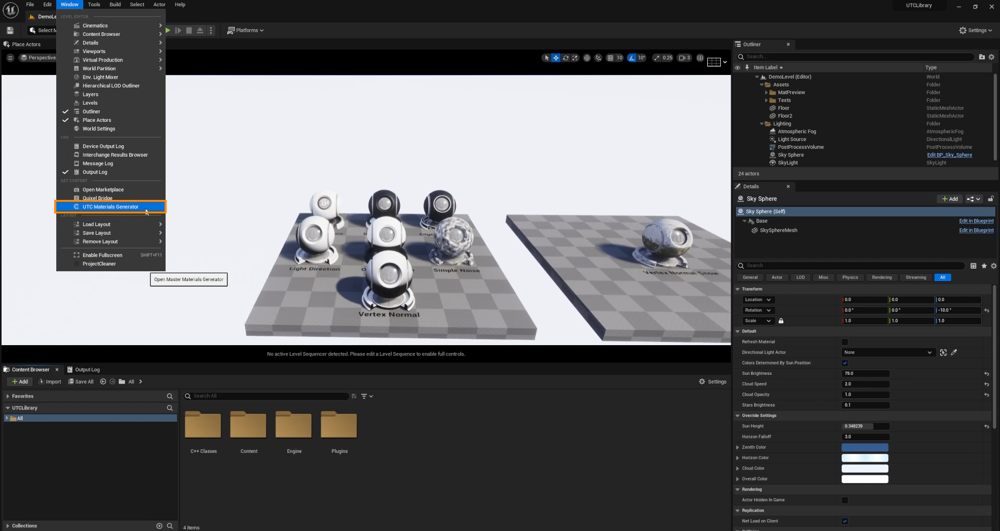

## Concept

The MMG builds a master material by stacking layers of material attributes and masks, each made of material functions. Add as many layers as you need for the level of detail you want.

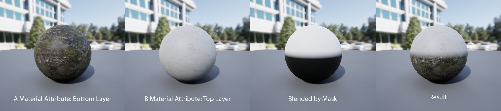

A simple material with a single material attribute works too.

The tool is customizable: you can add your own material functions for every node type.

Generated materials are regular materials, so they are a good starting point for more advanced materials.

## UI

### Tree View

The Tree View is the heart of the plugin. This is where you add material attributes and masks and connect them.

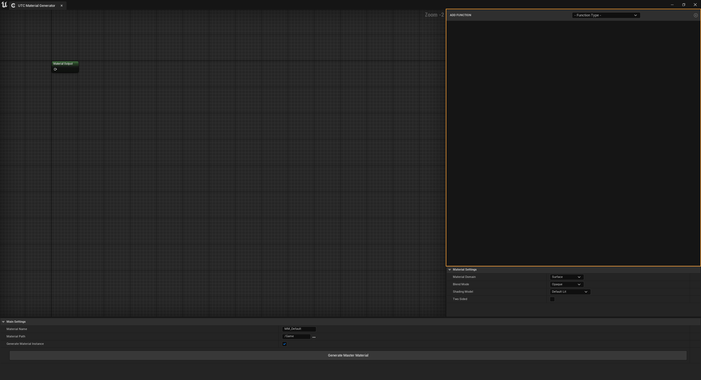

In the main header, pick **Material Attribute** or **Mask** in the Function Type combo box, then click the **+** button to add it to the list.

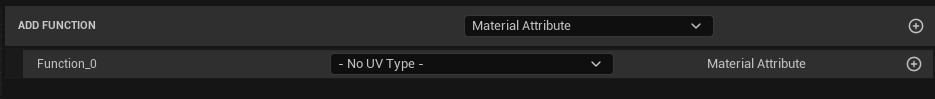

Each new parent header contains:

* the function name (`Function_x` by default),
* the UVs combo box, which selects the UVs used by the function's texture parameters,
* a label showing the function type,
* the **+** button, which adds elements to the function.

**Material attribute header**

Add as many elements as you want. Each combo box selects a material function connected to the material attribute.
Selecting the same function twice, or leaving a combo box empty, returns an error.
If you selected a UVs type, the checkbox to the right of each combo box enables or disables the UVs connection for that function.

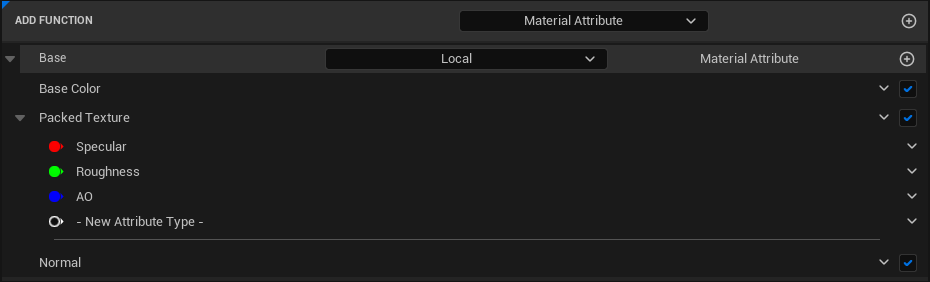

**Mask header**

A mask has a single element: a main combo box for the mask type, and two combo boxes for the functions it blends.

A mask can blend two material attributes, two masks, or a material attribute with another mask.

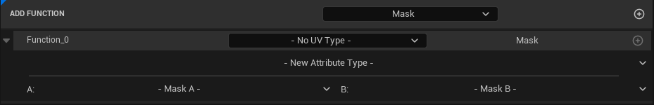

**Presets**

Right-click below the Tree View to open the preset menu and build Tree View setups faster.

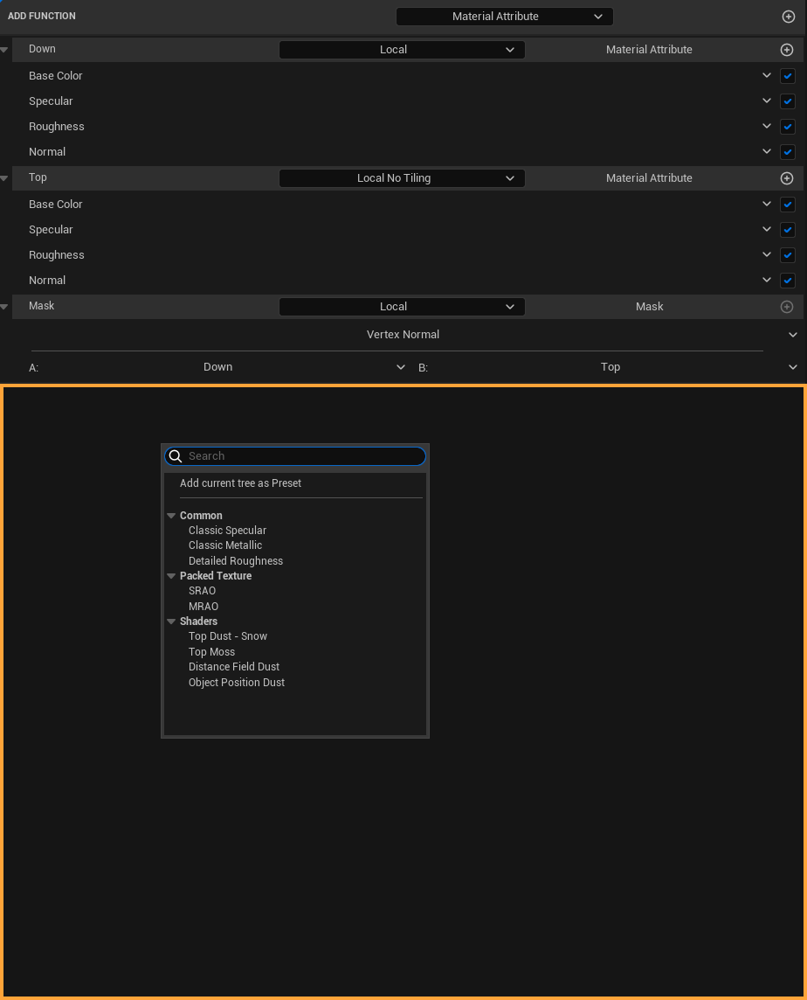

To save the current setup as a preset, click the menu header. In the dialog, enter the preset name and its menu category (pick an existing one or type a new one). The preset then appears in the preset menu.

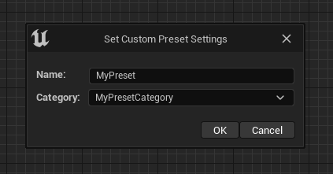

Presets are stored in the preset asset `Plugins > UTC Shader Library Content > Master Materials Generator > P_MainPresets`.

Warning: edit preset parameters there at your own risk.

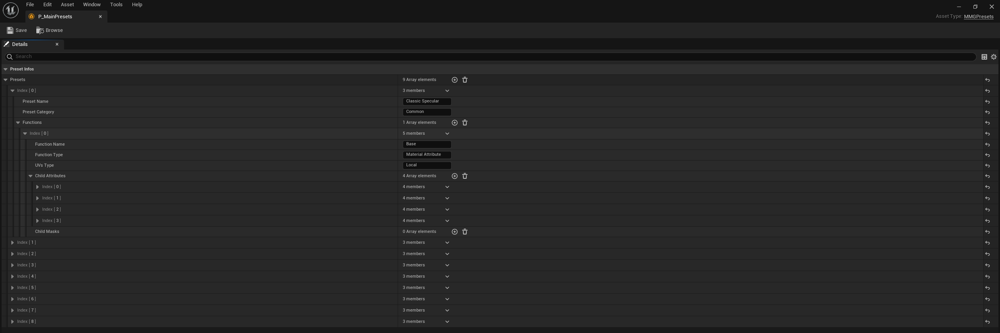

### Graph

The graph is read-only and follows the Tree View.

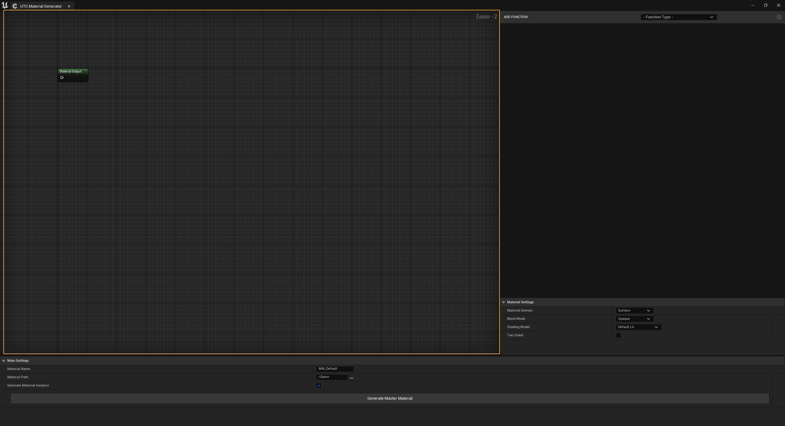

It shows four custom node types, the connections between them and the direction of the layers:

* Material Attribute node
* Mask node
* UVs node
* Material Output node

### Material Settings

The same settings as a regular material; the generated material uses the values selected here.

When Substrate is enabled in the project, **Generate Substrate Nodes** builds the material with Substrate nodes (Slab BSDFs blended by the masks) instead of material attributes.

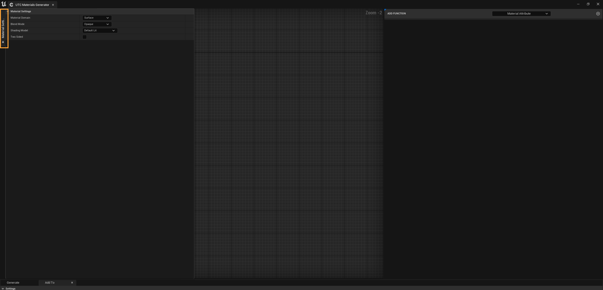

### Main Settings

**Generate Material**

Set the generated material's name, its Content Browser folder, and whether a material instance is created with it.

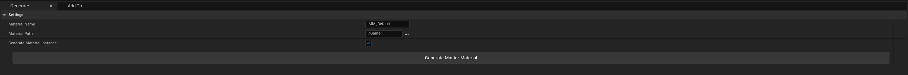

**Add to Material**

Adds the current Tree View functions to an existing material: drag and drop the target material, then click the button.
The target material's editor must be open in its own window (not docked).

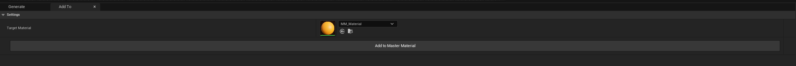

## Adding custom material functions

### Data tables

You can add your own material functions to every Tree View combo box. Three data tables hold them, one each for material attributes, masks and UVs.

They are in `Plugins > UTC Shader Library Content > Master Materials Generator`. For each row:

* **Row Name** is the name shown in the MMG combo boxes.
* **Material Function** is your material function (drag and drop it into the slot).
* **Material Attribute Type** is the material attribute input the function connects to.
* **Material Group** is the parameter group shown in the material instance.
* **MMG Menu Category** is the category the function appears under in the Tree View combo boxes.

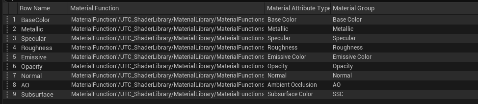

### Custom material function rules

When writing a material function for the MMG:

* If a vector or scalar input feeds a texture sampler, its name must start with `Texture` to be detected.
* To give a material instance parameter a custom default value, description or texture sampler type, check `Use Preview As Default Value` on the function input node and connect a node with the desired value to its Preview input.

# Material Function Library

All material functions are in the Content Browser under:

`Plugins > UTC Shader Library Content > Material Library > Material Functions`

## Masks

### Baked Texture
> MF_BakedMask

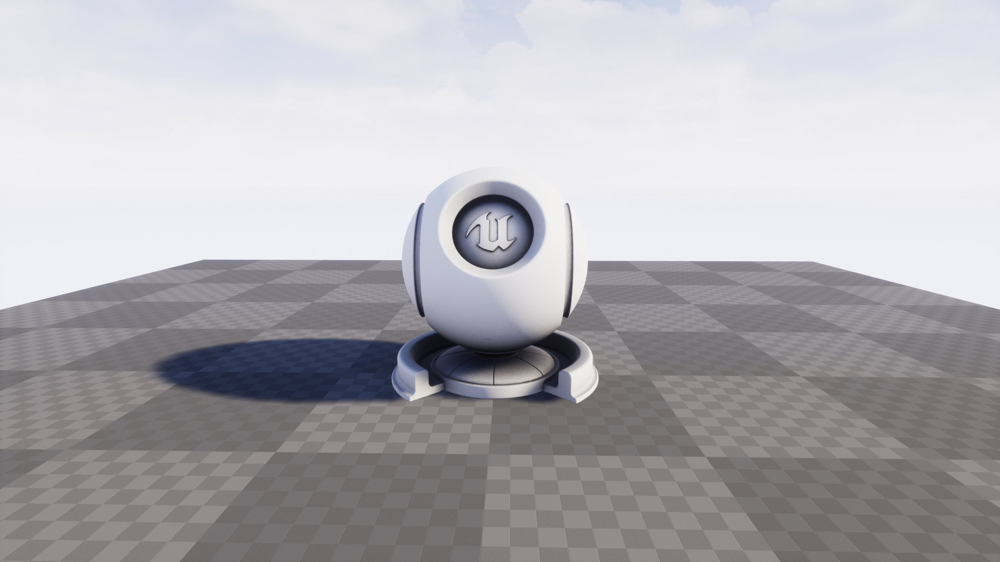

Uses a baked texture such as curvature, AO or thickness as a mask.

### Distance Field
> MF_MaskByDistanceField

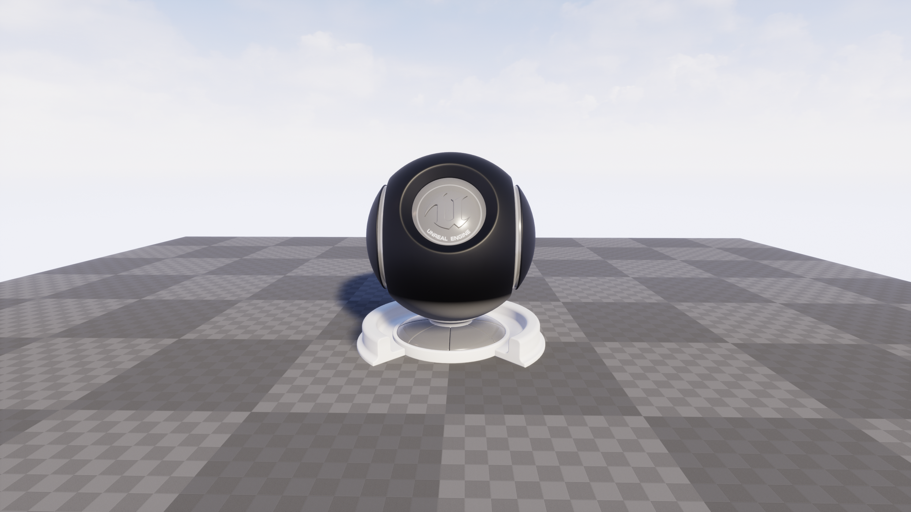

Tip: disable `Affect Distance Field Lighting` in the object's Details panel to remove its own distance field from the mask.

### Edge Detection
> MF_EdgeDetectionByVertexNormal

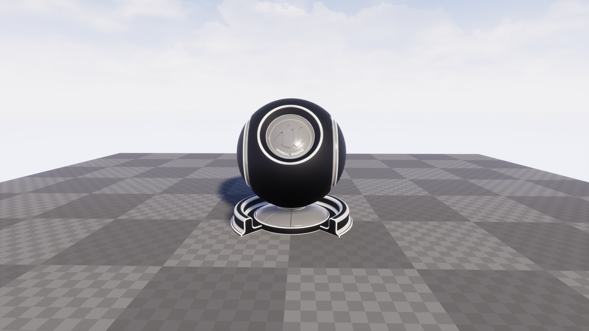

Responds to bevels; sharp, unbeveled edges are not detected.

### Light Direction
> MF_LightMask

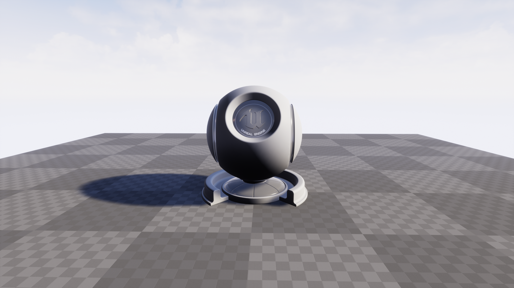

Driven by the direction of Directional Light [0].

### Object Position
> MF_MaskByObjectPosition

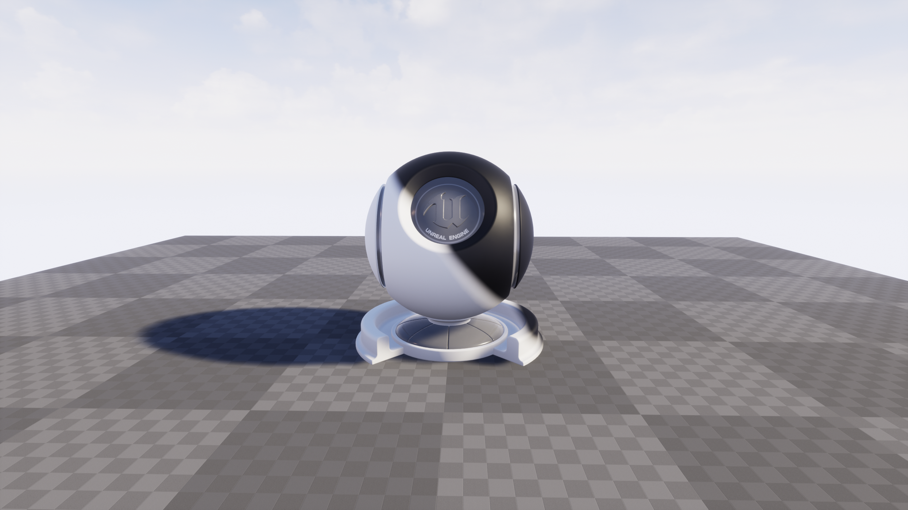

Offset and rotation are set manually; the mask follows the object's position.

### Simple Noise
> MF_SimpleNoiseVariation

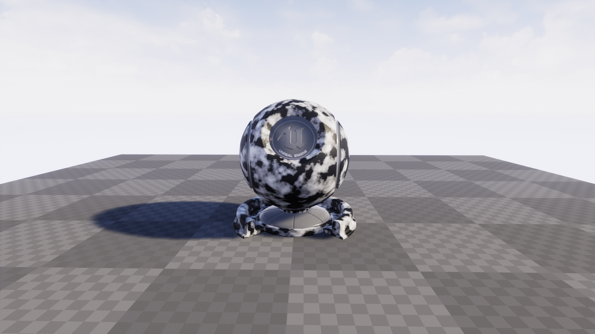

Adds a simple noise variation as a mask.

### Vertex Normal
> MF_MaskByVertexNormal

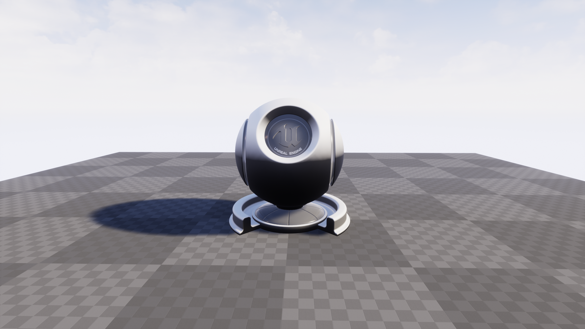

Uses the vertex normal's Z direction to add dust, snow and similar effects on top of the mesh.

## Material outputs

* Base Color
* Detail Base Color
* Metallic
* Detail Metallic
* Specular
* Detail Specular
* Roughness
* Detail Roughness
* Emissive
* Opacity
* Opacity Mask
* Normal
* Detail Normal
* AO
* Subsurface
* Fuzzy
* Distance Field PDO

## UVs

* Local
* Local no Tiling
* Triplanar
